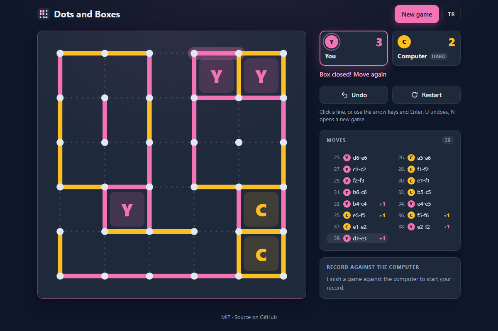

# Dots and Boxes - draw lines, close boxes and outplay a computer that knows the long-chain rule

[](#tests)
[](LICENSE)

**▶ Play now: https://celaldrg.github.io/dots-and-boxes/**



The pencil-and-paper classic, in the browser. You and your opponent take turns
joining two neighbouring dots. Whoever draws the fourth side of a box claims it
and moves again. Play the computer at three levels, or a friend on the same
device. It works on phones and with the keyboard, and has no build step and no
dependencies.

## Features

- Boards from 3 × 3 to 7 × 7 boxes. Play the computer or a friend on one device, and choose who moves first.
- Three computer levels:
  - **Easy** takes free boxes but sometimes gives boxes away.
  - **Medium** never hands over a box while a safe line is left. When it has to, it opens the shortest chain.
  - **Hard** counts chains to win the endgame. It plays the long-chain rule, keeps control by double-dealing and opens chains and loops in the best order. In the tests it beats Medium in at least 35 of 50 games.
- The last line is highlighted. Closed boxes get the owner's colour and initial, with a short pulse.
- Undo. Against the computer it takes back your last line and the computer's reply.
- A move list with line names such as `a1-b1`: columns are letters from the left and rows are numbers from the top.
- Your wins, losses and draws for each level are saved in the browser.
- English and Turkish. The language you pick is remembered.
- Made for phones first: big tap targets and touch input, with no zooming or sideways scrolling. On desktop you get a hover preview and full keyboard play.
- The page respects *reduced motion*, loads nothing from other sites and uses no cookies or trackers.
- Built with plain HTML, CSS and JavaScript modules.

## How to play

**Rules.** Players take turns drawing one line between two dots that are next to
each other. If your line completes a box, the box is yours and you draw again.
Once every line is drawn, the player with more boxes wins.

| | Draw a line | Other |
| --- | --- | --- |
| **Touch** | Tap near the line. The nearest free line within half a box is drawn. Hold your finger down to see a preview, slide to change it, and lift to draw. | Buttons for **Undo**, **Restart** and **New game** |
| **Mouse** | Hover to see a preview, click to draw | The same buttons |
| **Keyboard** | <kbd>Tab</kbd> to the board. The arrow keys move the cursor and <kbd>Enter</kbd> or <kbd>Space</kbd> draws the line. | <kbd>U</kbd> or <kbd>Ctrl</kbd>/<kbd>⌘</kbd>+<kbd>Z</kbd> undoes and <kbd>N</kbd> opens **New game** |

**Tip.** Try not to draw the third side of a box, because that hands the box to
your opponent. Late in the game every line gives something away. Then the
player who has to open the long chains usually loses. Hard counts chains so that
this player is you.

## Run locally

ES modules do not load from `file://`, so the page has to be served over `http://`.

```sh
npx serve .
```

Open the address it prints, for example http://localhost:3000. Any static file
server works. Add `?demo` to the URL (http://localhost:3000/?demo) to load the
fixed mid-game used for the screenshot.

## Tests

```sh
node --test
```

You need Node.js 22 or newer. There is nothing to install. The tests cover:

- the rules, turns, undo and results;
- board geometry, hit-testing and the keyboard cursor;
- the chain and loop analysis;
- every computer level, including brute-force checks of the Hard player on small endgames, a middle game it must win on chain parity, and a timing budget on 7 × 7;
- the demo position, the saved record, the setup, the translations and the storage helper;
- static checks of the page.

## Project structure

```text
index.html          page markup
style.css           dark theme, responsive layout, animations
src/
  main.js           entry point: connects the game to the page, runs the computer player
  board-view.js     SVG board, pointer and keyboard input
  panel.js          scores, status line, move list, record
  overlay.js        game-over card
  setup-dialog.js   "New game" dialog
  dom.js            small DOM helpers
  game.js           rules, turns, undo, result               (pure)
  board.js          geometry, line numbering, hit-testing    (pure)
  ai.js             computer levels                          (pure)
  chains.js         chain and loop analysis                  (pure)
  position.js       analysis board used by the computer      (pure)
  rng.js            seeded random numbers                    (pure)
  demo.js           fixed mid-game for ?demo                 (pure)
  stats.js          wins, losses and draws per level         (pure)
  settings.js       setup validation                         (pure)
  status.js         status line messages                     (pure)
  i18n.js           English and Turkish strings              (pure)
  storage.js        guarded localStorage helper
test/               node:test suites
docs/screenshot.png
```

The modules marked *pure* do not touch the DOM or storage, so `node --test`
imports them directly. All randomness comes from a seeded generator, which keeps
the tests deterministic.

## License

[MIT](LICENSE) © 2026 Celalettin Durgaç

## Türkçe

**▶ Hemen oyna: https://celaldrg.github.io/dots-and-boxes/**

**Noktalar ve Kutular**, kâğıt kalemle oynanan klasik oyunun tarayıcı sürümü.
Rakibinle sırayla yan yana iki noktayı birleştirirsin. Bir kutunun dördüncü
kenarını çizen kutuyu alır ve yeniden oynar. Üç seviyeli bilgisayara karşı ya da
aynı cihazda bir arkadaşınla oynayabilirsin. Telefonda da klavyeyle de çalışır.
Derleme adımı ve bağımlılığı yoktur.

### Özellikler

- 3 × 3'ten 7 × 7'ye kadar tahtalar. Bilgisayara karşı ya da aynı cihazda iki kişi oynanır ve ilk hamleyi kimin yapacağı seçilebilir.
- Üç bilgisayar seviyesi:
  - **Kolay** boştaki kutuları alır ama bazen kutu verir.
  - **Orta** güvenli çizgi kaldıkça kutu vermez. Vermek zorunda kalınca en kısa zinciri açar.
  - **Zor** oyun sonunu kazanmak için zincirleri sayar. Uzun zincir kuralını uygular, kontrolü elinde tutmak için gerektiğinde son kutuları rakibe bırakır ve zincirleri en iyi sırayla açar. Testlerde 50 oyunun en az 35'inde Orta'yı yener.
- Son çizilen çizgi vurgulanır. Kapanan kutu, sahibinin rengini ve baş harfini kısa bir animasyonla alır.
- Geri al. Bilgisayara karşı son çizginle birlikte bilgisayarın cevabını da geri alır.
- `a1-b1` gibi çizgi adlarıyla hamle listesi: sütunlar soldan harf, satırlar yukarıdan sayıdır.
- Her seviyedeki galibiyet, mağlubiyet ve beraberliklerin tarayıcıda saklanır.
- İngilizce ve Türkçe. Seçtiğin dil hatırlanır.
- Önce telefon için tasarlandı: büyük dokunma alanları ve dokunmatik kontrol var, yakınlaştırma ya da yana kaydırma gerekmez. Masaüstünde fareyle önizleme ve tam klavye kontrolü vardır.
- Sayfa *azaltılmış hareket* ayarına uyar, başka sitelerden hiçbir şey yüklemez, çerez ya da izleyici kullanmaz.
- Düz HTML, CSS ve JavaScript modülleriyle yazıldı.

### Nasıl oynanır

**Kurallar.** Oyuncular sırayla yan yana iki nokta arasına bir çizgi çizer. Çizgin
bir kutuyu tamamlarsa kutu senindir ve yeniden çizersin. Bütün çizgiler
çizildiğinde daha çok kutusu olan kazanır.

- **Dokunmatik:** Çizginin yakınına dokun. Yarım kutu mesafedeki en yakın boş çizgi çizilir. Parmağını basılı tutarsan önizlemeyi görürsün, kaydırarak değiştirebilir, kaldırınca çizersin.
- **Fare:** Önizleme için üzerine gel, çizmek için tıkla.
- **Klavye:** <kbd>Tab</kbd> ile tahtaya geç. Ok tuşları imleci taşır, <kbd>Enter</kbd> ya da <kbd>Boşluk</kbd> çizgiyi çizer. <kbd>U</kbd> veya <kbd>Ctrl</kbd>/<kbd>⌘</kbd>+<kbd>Z</kbd> geri alır, <kbd>N</kbd> **Yeni oyun** penceresini açar.

**İpucu.** Bir kutunun üçüncü kenarını çizmemeye çalış, çünkü bu kutuyu rakibe
verir. Oyunun sonuna doğru her çizgi bir şey kaybettirir. O zaman uzun
zincirleri açmak zorunda kalan çoğu zaman kaybeder. Zor seviye, bu oyuncunun sen
olması için zincirleri sayar.

### Yerelde çalıştırma

ES modülleri `file://` üzerinden yüklenmez. Sayfanın `http://` ile sunulması gerekir.

```sh
npx serve .
```

Çıkan adresi aç, örneğin http://localhost:3000. Herhangi bir statik dosya
sunucusu da olur. Ekran görüntüsündeki sabit oyun ortası için adrese `?demo` ekle.

### Testler

```sh
node --test
```

Node.js 22 veya üstü gerekir, ayrıca bir şey kurmaya gerek yoktur. Testler
şunları kapsar:

- kurallar, sıra, geri alma ve sonuç;
- tahta geometrisi, dokunma noktasından çizgi bulma ve klavye imleci;
- zincir ve döngü analizi;
- bütün bilgisayar seviyeleri: küçük oyun sonlarında Zor seviyenin kaba kuvvetle doğrulanması, zincir paritesiyle kazanması gereken bir oyun ortası ve 7 × 7'de süre sınırı dahil;
- demo pozisyonu, kayıtlı sonuçlar, ayarlar, çeviriler ve depolama yardımcısı;
- sayfanın statik kontrolleri.

### Proje yapısı

```text
index.html          sayfa yapısı
style.css           koyu tema, uyumlu yerleşim, animasyonlar
src/
  main.js           giriş noktası: oyunu sayfaya bağlar, bilgisayar oyuncusunu çalıştırır
  board-view.js     SVG tahta, işaretçi ve klavye girişi
  panel.js          skorlar, durum satırı, hamle listesi, kayıt
  overlay.js        oyun sonu kartı
  setup-dialog.js   "Yeni oyun" penceresi
  dom.js            küçük DOM yardımcıları
  game.js           kurallar, sıra, geri alma, sonuç               (saf)
  board.js          geometri, çizgi numaraları, dokunma testi     (saf)
  ai.js             bilgisayar seviyeleri                          (saf)
  chains.js         zincir ve döngü analizi                        (saf)
  position.js       bilgisayarın kullandığı analiz tahtası         (saf)
  rng.js            tohumlu rastgele sayılar                       (saf)
  demo.js           ?demo için sabit oyun ortası                   (saf)
  stats.js          seviye başına galibiyet, yenilgi, beraberlik   (saf)
  settings.js       kurulum doğrulaması                            (saf)
  status.js         durum satırı mesajları                         (saf)
  i18n.js           İngilizce ve Türkçe metinler                   (saf)
  storage.js        korumalı localStorage yardımcısı
test/               node:test test takımları
docs/screenshot.png
```

*Saf* diye işaretli modüller DOM'a ve depolamaya dokunmaz, bu yüzden `node --test`
onları doğrudan içe aktarır. Bütün rastgelelik tohumlu bir üreteçten gelir; testler
bu yüzden her çalıştırmada aynı sonucu verir.

### Lisans

[MIT](LICENSE) © 2026 Celalettin Durgaç
